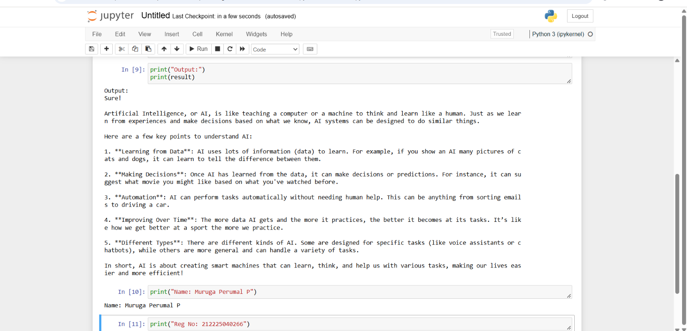

## Design and Implementation of LangChain Expression Language (LCEL) Expressions

### AIM:
To design and implement a LangChain Expression Language (LCEL) expression that utilizes at least two prompt parameters and three key components (prompt, model, and output parser), and to evaluate its functionality by analyzing relevant examples of its application in real-world scenarios.

### PROBLEM STATEMENT:

### DESIGN STEPS:

#### STEP 1:
Import the required libraries and load the OpenAI API key to establish a connection with the LangChain chat model.
#### STEP 2:
Create a chat prompt template with two parameters, namely topic and style. Initialize the language model and configure the string output parser.
#### STEP 3:
Combine the prompt, model, and output parser using the LCEL pipe operator (|). Invoke the chain by providing the required input parameters and display the generated response.
### PROGRAM:
```
import os
from dotenv import load_dotenv, find_dotenv

from langchain.prompts import ChatPromptTemplate
from langchain.chat_models import ChatOpenAI
from langchain.schema.output_parser import StrOutputParser

_ = load_dotenv(find_dotenv())
os.environ["OPENAI_API_KEY"] = os.getenv("OPENAI_API_KEY")

prompt = ChatPromptTemplate.from_template(
    "Explain {topic} in a {style} way."
)

model = ChatOpenAI(
    model="gpt-4o-mini",
    temperature=0
)

output_parser = StrOutputParser()

chain = prompt | model | output_parser

result = chain.invoke({
    "topic": "Artificial Intelligence",
    "style": "simple and easy to understand"
})

print("Output:")
print(result)
```

### OUTPUT:



### RESULT:
Thus, the LangChain Expression Language (LCEL) expression was successfully designed and implemented using two prompt parameters and three key components: prompt, model, and output parser. The system generated the required response based on the given inputs.